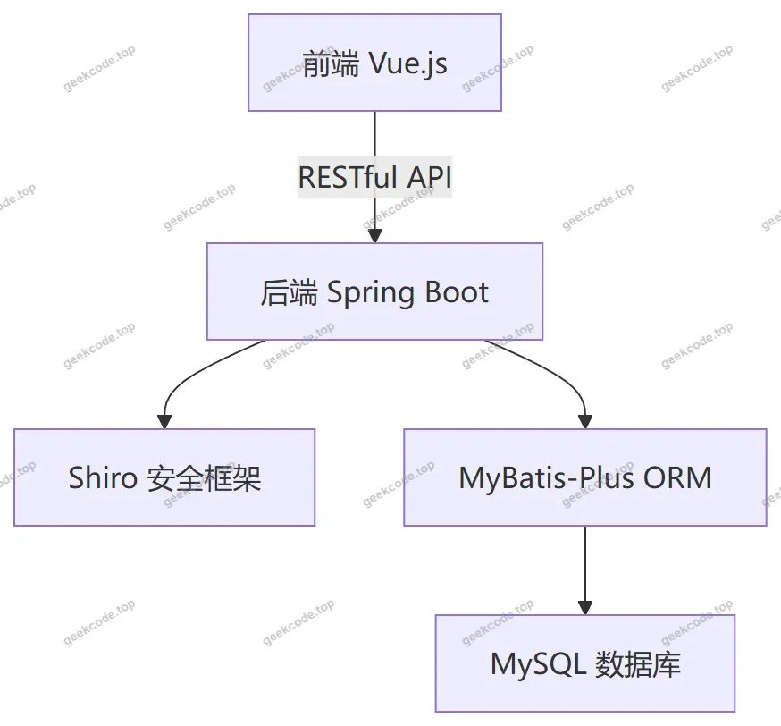
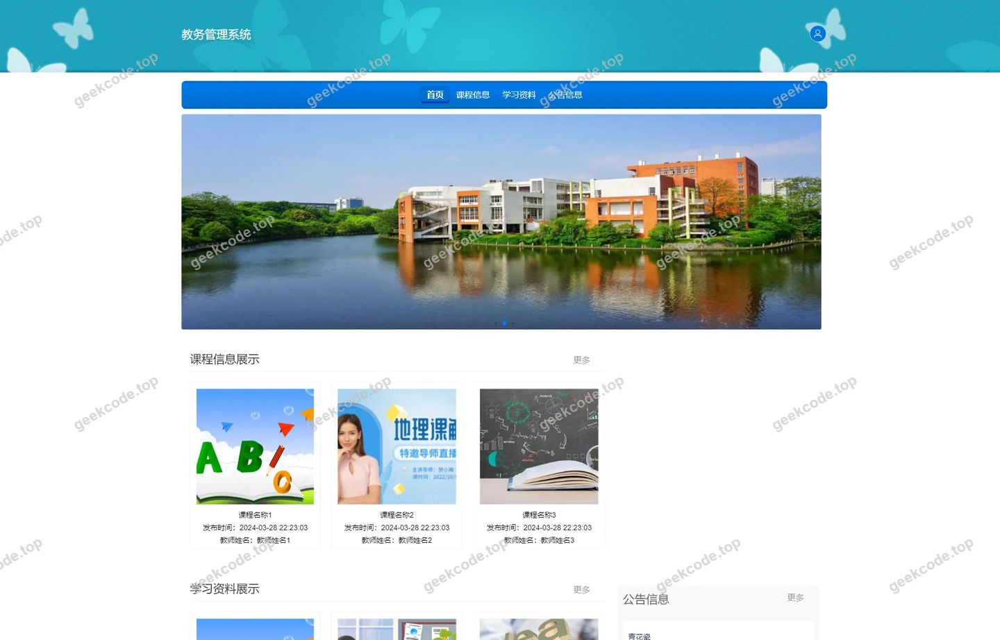
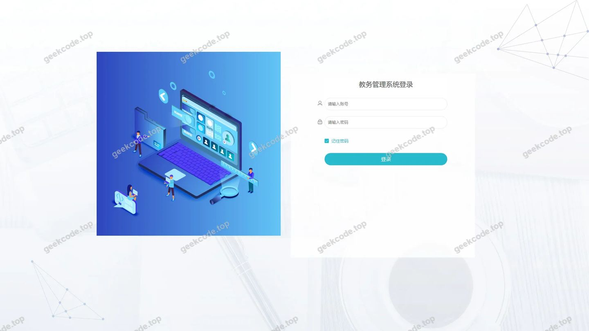
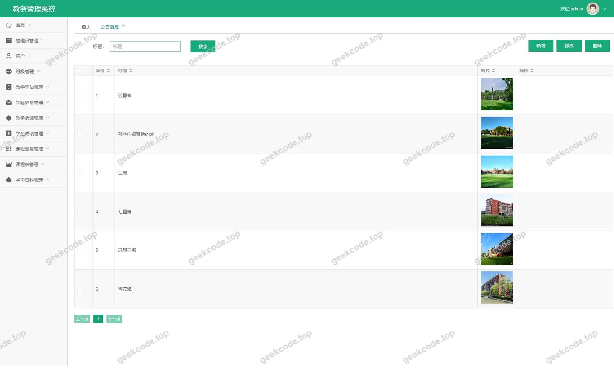
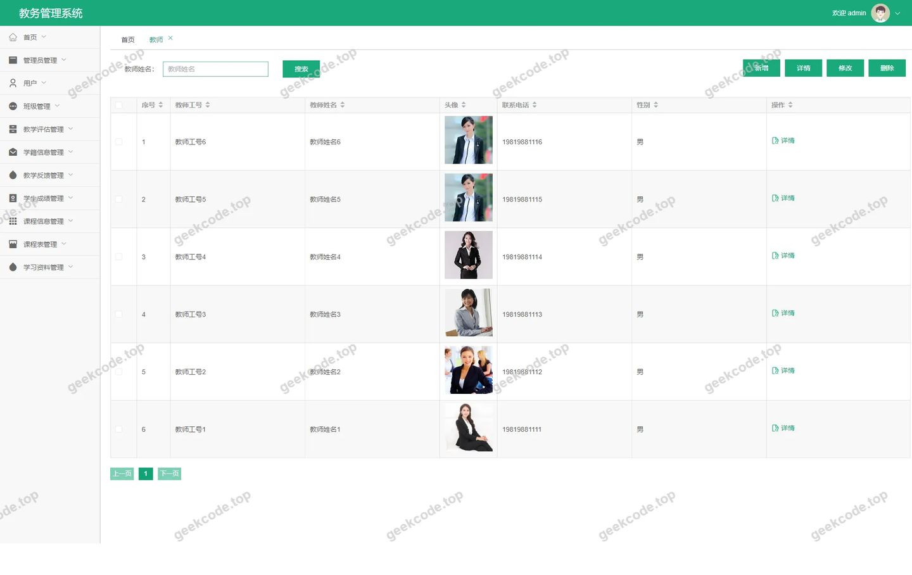
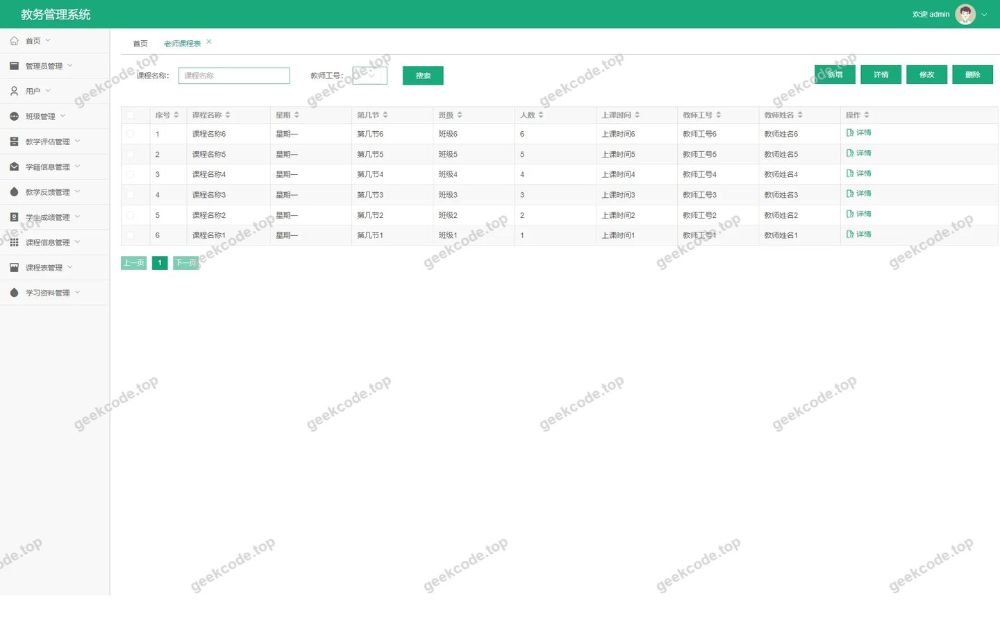
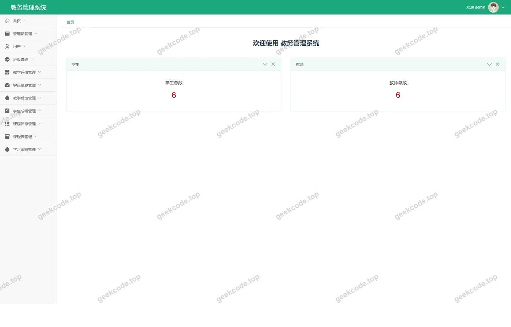
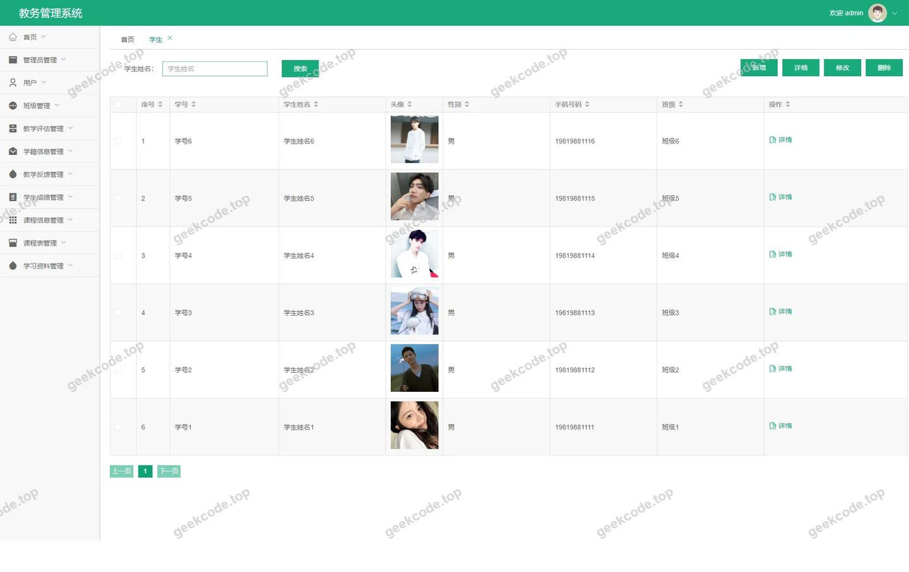
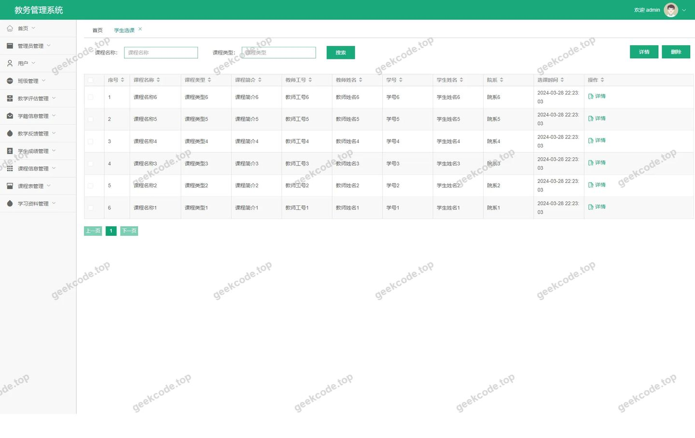
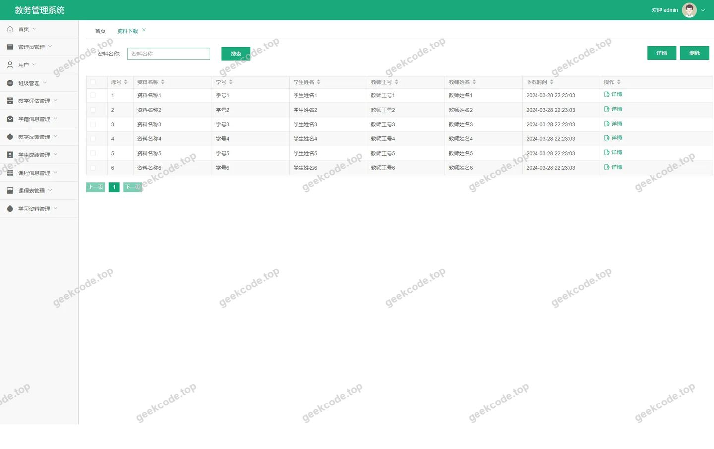

# Java教务管理系统

> 🎓 **计算机毕业设计 · Java教务管理系统**
>
> 本仓库只放**项目介绍 + 运行截图**（截图是站点带水印的原图，存在仓库 `images/` 里）。
>
> 👉 **完整可运行源码 / 数据库脚本 / 部署文档：[点我获取](https://geekcode.top/archives/Java%E6%95%99%E5%8A%A1%E7%AE%A1%E7%90%86%E7%B3%BB%E7%BB%9F?utm_source=github)**
>
> 💬 咨询微信：**ir9372**　|　🌐 更多项目：[极客代码 geekcode.top](https://geekcode.top/?utm_source=github)
>
> 📌 项目详情页：<https://geekcode.top/archives/Java%E6%95%99%E5%8A%A1%E7%AE%A1%E7%90%86%E7%B3%BB%E7%BB%9F?utm_source=github>

<table><td width="230" align="center"> <b>扫码加微信 ir9372</b></td><td valign="middle">📦 源码 = 项目介绍 + 全部运行截图 + 数据库 + 部署文档 👉 点上方任意截图，直接跳到 <b>极客代码 geekcode.top</b> 详情页</td></table>

---

<h1>Java教务管理系统</h1>
<h2>项目概述</h2>

Java教务管理系统旨在为高校或教育机构提供一套高效、规范的数字化教学管理解决方案。系统采用前后端分离架构，核心功能涵盖学生信息管理、教师档案管理、课程信息维护、学生选课流程、成绩录入与查询、教师课表展示以及教学资源下载等模块。适用人群主要包括学校教务处管理人员、任课教师及在校学生。通过本系统，管理员可集中处理教务数据，教师可查看个人课表并反馈教学情况，学生则能在线完成选课、查看成绩及获取学习资料，从而显著提升教务工作的自动化水平与信息流转效率。

<h2>技术架构</h2>

本项目基于 Spring Boot 框架构建后端服务，利用其自动配置特性简化开发流程，确保系统的稳定性与可扩展性。持久层采用 MyBatis-Plus 框架，结合 MySQL 数据库实现数据的高效存储与复杂查询操作，MyBatis-Plus 提供的通用 CRUD 接口大幅减少了样板代码的编写。安全控制方面引入 Apache Shiro 框架，负责用户身份认证与权限授权，保障系统访问的安全性。前端界面基于 Vue.js 生态体系（vue-integrated）开发，通过 RESTful API 与后端进行数据交互，实现了页面动态渲染与用户体验优化。整体架构清晰分层，易于维护与迭代。

<h2>功能模块</h2>
<h3>前台用户端</h3>

前台主要面向学生与教师提供自助服务入口，具体功能包括：

<ol>
<li><strong>首页浏览</strong>：展示公告信息及系统概览。</li>
<li><strong>学生中心</strong>：支持学生列表查看、详情浏览、个人信息添加与维护、个人中心管理。</li>
<li><strong>教师中心</strong>：支持教师列表查看、详情浏览及个人信息添加。</li>
<li><strong>课程与选课</strong>：包含课程信息列表、详情及新增；学生选课记录的列表、详情及新增操作。</li>
<li><strong>成绩与课表</strong>：提供学生成绩的列表、详情及新增视图；教师课表的列表、详情及新增视图。</li>
<li><strong>班级管理</strong>：支持班级信息的列表、详情及新增。</li>
<li><strong>教学资源</strong>：包含资料类型管理、学习资料的列表、详情及新增，以及资料下载功能。</li>
<li><strong>其他功能</strong>：支持收藏列表查看、新闻公告列表浏览。</li>
</ol>
<h3>后台管理端</h3>

后台主要面向管理员提供全面的数据管理与系统配置功能，具体路由对应模块如下：

<ol>
<li><strong>教师中心管理</strong>：对教师账户及信息进行综合管理。</li>
<li><strong>新闻公告管理</strong>：发布与维护系统通知及新闻内容。</li>
<li><strong>学生选课管理</strong>：审核与管理学生的选课记录。</li>
<li><strong>学生信息管理</strong>：维护全校学生基础档案。</li>
<li><strong>资料下载管理</strong>：管理可供下载的教学文档资源。</li>
<li><strong>老师课程表管理</strong>：生成与维护教师的授课时间表。</li>
<li><strong>教师信息管理</strong>：维护全校教师基础档案。</li>
<li><strong>学生成绩管理</strong>：录入、修改及统计学生考试成绩。</li>
<li><strong>课程信息管理</strong>：定义与维护开设的课程详情。</li>
<li><strong>教学反馈管理</strong>：收集与处理教学质量反馈意见。</li>
<li><strong>教学评估管理</strong>：执行与记录教学评估结果。</li>
<li><strong>资料类型管理</strong>：分类管理各类教学资源。</li>
<li><strong>学习资源管理</strong>：上传与维护在线学习内容。</li>
<li><strong>班级管理</strong>：维护行政班级或教学班级信息。</li>
<li><strong>系统配置</strong>：设置系统参数与全局配置项。</li>
<li><strong>学籍信息管理</strong>：专门管理学生的学籍状态与相关档案。</li>
</ol>
<h2>用户角色与权限</h2>

根据系统路由结构与功能划分，主要涉及以下角色及其权限范围：

<ol>
<li>
<strong>管理员 (Admin)</strong>

<ul>
<li><strong>权限范围</strong>：拥有最高权限，可访问所有后台管理模块。</li>
<li><strong>具体功能</strong>：全面管理学生、教师、班级、课程、选课、成绩、课表、教学资源、新闻公告、教学反馈与评估、学籍信息及系统配置。负责数据的增删改查及系统运行监控。</li>
</ul>
</li>
<li>
<strong>教师 (Teacher)</strong>

<ul>
<li><strong>权限范围</strong>：主要使用前台“教师中心”及相关业务模块。</li>
<li><strong>具体功能</strong>：查看和管理个人基本信息（教师详情、添加）；查看个人课程表（老师课程表列表/详情）；可能涉及教学反馈提交（依据前台路由推断，但未明确标注教师专属提交入口，故仅确认其可见性与基础信息管理）。</li>
</ul>
</li>
<li>
<strong>学生 (Student)</strong>

<ul>
<li><strong>权限范围</strong>：主要使用前台“学生中心”及相关业务模块。</li>
<li><strong>具体功能</strong>：查看和管理个人基本信息（学生详情、添加）；进行选课操作（学生选课列表/详情/添加）；查询个人成绩（学生成绩列表/详情）；浏览课程信息；下载学习资料；查看班级信息；关注新闻公告；管理个人收藏。</li>
</ul>
</li>
</ol>

<em>注：根据现有源码路由结构，未明确区分超级管理员与普通教务员的权限差异，上述角色权限基于标准教务系统逻辑及路由归属推导。</em>

<h2>项目特色与创新点</h2>
<ol>
<li><strong>全流程闭环管理</strong>：系统覆盖了从学籍建立、课程开设、学生选课、教师排课到成绩录入、教学评估的完整教务生命周期，实现了数据的一致性关联。</li>
<li><strong>资源整合与服务化</strong>：将传统的纸质或分散式教学资源（如课件、参考书）数字化，通过“资料下载”和“学习资源”模块统一分发，提升了知识共享效率。</li>
<li><strong>多维度反馈机制</strong>：除了常规的成绩管理，还引入了“教学反馈”和“教学评估”模块，为教学质量监控提供了数据支撑，体现了以学生为中心的教育服务理念。</li>
<li><strong>灵活的角色视图</strong>：通过前后台分离设计，为学生、教师和管理员提供了定制化的操作界面，既保证了管理端的严谨性，又提升了用户端的易用性。</li>
</ol>
<h2>部署环境</h2>

为确保 Java教务管理系统正常运行，需准备以下软件环境：

<ol>
<li><strong>JDK</strong>：建议版本 JDK 1.8 或更高，用于编译和运行 Spring Boot 后端程序。</li>
<li><strong>MySQL</strong>：建议版本 MySQL 5.7 或 MySQL 8.0，用于存储系统业务数据。</li>
<li><strong>Maven</strong>：用于依赖管理及项目构建打包。</li>
<li><strong>Node.js &amp; npm</strong>：建议 Node.js v14+，用于前端 Vue 项目的依赖安装与编译打包。</li>
<li><strong>浏览器</strong>：Chrome、Edge 或 Firefox 等现代主流浏览器，用于访问前端页面。</li>
<li><strong>服务器操作系统</strong>：Windows Server、Linux (CentOS/Ubuntu) 均可支持。</li>
</ol>
<h2>五、技术特性</h2>
<ul>
<li>前后端集成部署，前端资源打包至后端 static 目录</li>
<li>使用 MyBatis-Plus 简化数据访问层开发</li>
<li>集成 Shiro 权限框架实现角色权限控制</li>
</ul>
<h2>六、功能模块截图</h2>
<h3>前台用户端</h3>
<h4>前台-首页</h4>

<h4>前台-登录</h4>

<h3>后台管理端</h3>
<h4>后台-登录页</h4>

<h4>后台-公告信息</h4>

<h4>后台-教师</h4>

<h4>后台-老师课程表</h4>

<h4>页面-首页</h4>

<h4>后台-学生</h4>

<h4>后台-学生选课</h4>

<h4>后台-资料下载</h4>

---

## 获取完整源码

| 项目 | 说明 |
| --- | --- |
| 项目名 | Java教务管理系统 |
| 运行截图 | 本文 11 张（站点带水印原图，仓库 `images/` 目录） |
| 完整源码 | [https://geekcode.top/archives/Java%E6%95%99%E5%8A%A1%E7%AE%A1%E7%90%86%E7%B3%BB%E7%BB%9F?utm_source=github](https://geekcode.top/archives/Java%E6%95%99%E5%8A%A1%E7%AE%A1%E7%90%86%E7%B3%BB%E7%BB%9F?utm_source=github) |
| 咨询微信 | **ir9372**（备注：jingpin-yuanma） |
| 更多项目 | [极客代码 geekcode.top](https://geekcode.top/?utm_source=github) |

> 需要源码、部署、改配置、跑不起来等问题，加微信 ir9372 沟通，说明项目名即可。
